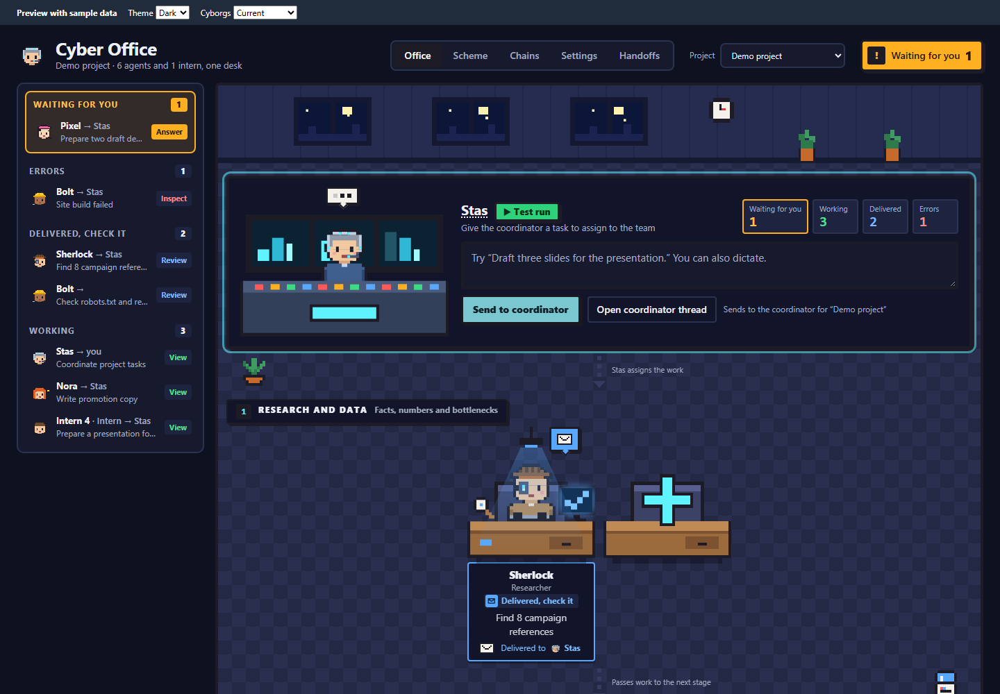
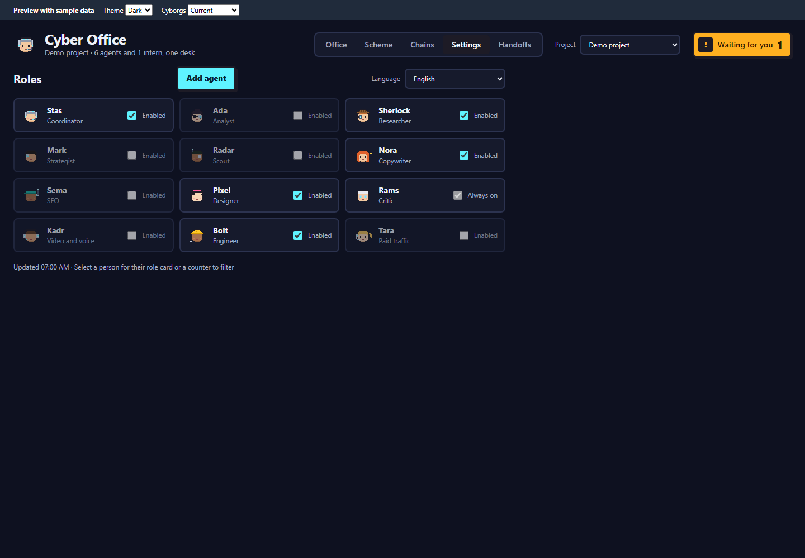
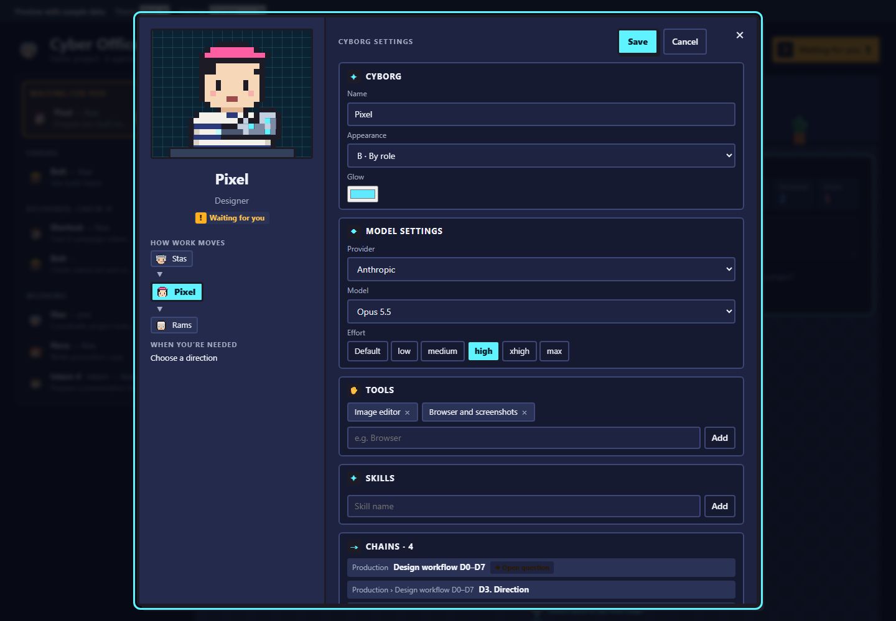
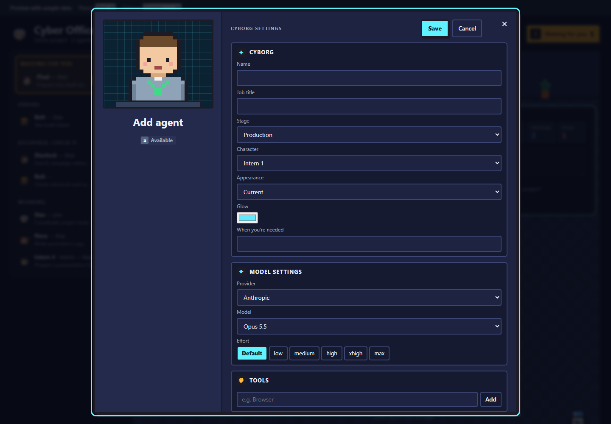
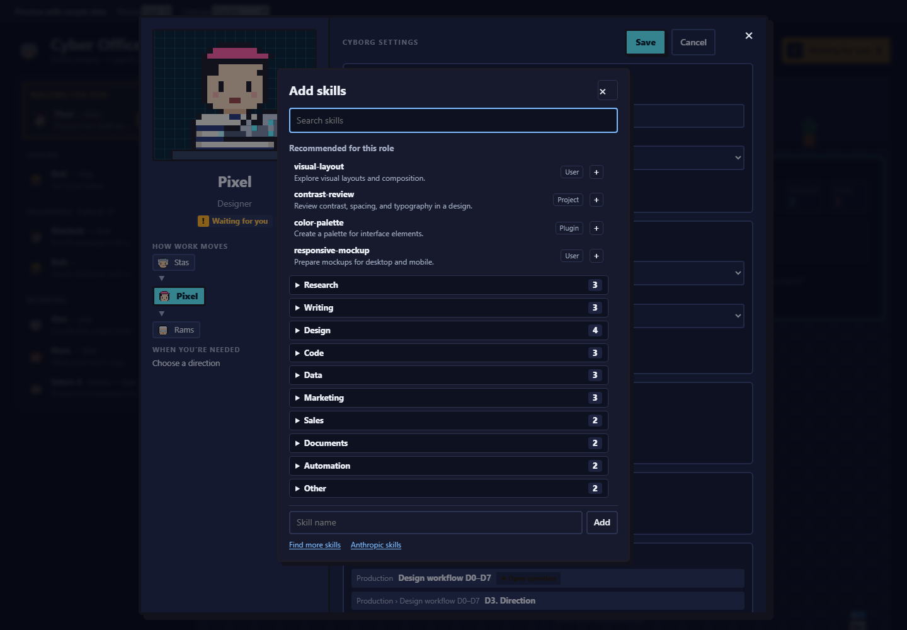
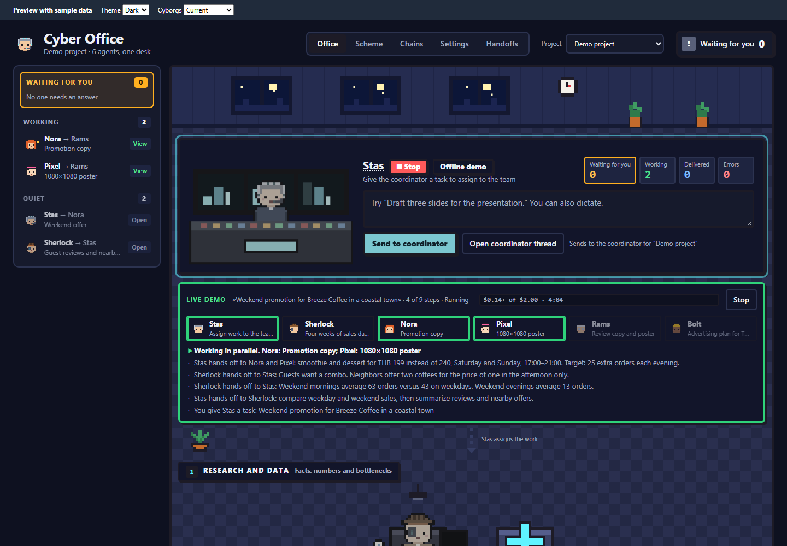

# Cyber Office

A team of agents for BB with roles, a coordinator, and a critic. You give one task to Stas, the coordinator. He splits it, specialists do the work, the critic checks it, and you get one question at a time.



## Who it is for

- **You run several agent threads and lose track.** The office shows who is working, who is waiting for you, and who hit an error.
- **You are not a developer.** Founders, marketers, and small agencies get ready roles: researcher, copywriter, designer, analyst, strategist, SEO, paid traffic, video.
- **You have two subscriptions.** Let Claude write and ChatGPT criticize, or the other way round. A critic on a different model catches more.
- **You are tired of "done" without proof.** Work is accepted on evidence: a file, a check, a fact.

It is less useful if you work in a single coding thread, or if you want agents to run unattended in separate git worktrees. Cyber Office keeps you in the loop on purpose.

## What you get

- **An office you can read at a glance.** Every role is a pixel cyborg at a desk, five in a row, grouped by stage. Click a cyborg to open its card or its thread.
- **A coordinator named Stas.** You talk to Stas. He hands each piece to the right role with a brief: goal, files, limits, and what "done" looks like.
- **A critic on every job.** Rams reviews the result before it reaches you. He cannot be switched off.
- **One question at a time.** When an agent needs you, you get a single card with options and a default. Click an option or type your own answer.
- **Result cards.** Every reply starts with a short card: status, result in one line, what is needed from you, files, what was checked.
- **Your own team.** Rename the cyborgs, change how they look, pick a model for each, add your own agents, and hand them your skills.

## Install

```
bb plugin install https://github.com/marketing-g/bb-plugin-cyber-office
```

Requires BB 0.49 or newer. The plugin uses the providers you already have in BB and needs no account or API key of its own.

## First run

Open a thread in your project and ask:

> Set up my Cyber Office team

The `team-setup` skill reads your project, your installed skills, and your connected providers. It proposes a team: which roles to switch on, which of your skills each role gets, which model each role runs on, and three first tasks. Nothing is applied until you say yes.

Then open the **Cyber Office** page in the BB sidebar, pick your project, type a task in the field next to Stas, and press **Send to coordinator**.

## The team

| Cyborg | Role | On by default |
|---|---|---|
| Stas | Coordinator | yes |
| Sherlock | Researcher | yes |
| Bolt | Engineer | yes |
| Pixel | Designer | yes |
| Nora | Copywriter | yes |
| Rams | Critic | yes, always |
| Ada | Analyst | no |
| Mark | Strategist | no |
| Sema | SEO | no |
| Kadr | Video and voice | no |
| Tara | Paid traffic | no |
| Radar | Scout | no, experimental |

The second half is a marketing team. Switch it on in the Settings tab if you run campaigns, landing pages, or content.



## Customize your cyborgs

Click a cyborg to open its card. There you can change its name, its look and glow color, and the provider, model, and effort it runs on.



**Add your own agent.** Every stage has an empty desk with a plus. Click it, give the agent a name, a job title, a look, and a model, and it joins the team like the built-in roles. You can switch it off or delete it later.



**Pick skills by category.** In the card, press **Add** next to Skills. The panel lists the skills already installed on your computer, grouped into Research, Writing, Design, Code, Data, Marketing, Sales, Documents, Automation, and Other. The ones that fit the role sit at the top. Each row says where the skill lives: your own folder, the project, or a plugin. Search works across names and descriptions, and you can still type a name by hand. Categories are guessed from keywords, so use search when a skill is not where you expect it.



Need more skills? The two links at the bottom of the panel open [skills.sh](https://skills.sh) and the [Anthropic skills repository](https://github.com/anthropics/skills). Install a skill the usual way, reopen the panel, and it shows up.

**Tools are labels.** The **Add** button next to Tools offers ready labels by category: files, browser, web, terminal, data, media, connectors. A label tells the agent what it is expected to use. The tools themselves come from the provider and your MCP servers.

Changes are saved in the plugin's own storage and survive a restart. The interface is in English by default. Russian is one switch away in Settings.

## Try it without risk

Create an empty folder and add it to BB as a project named `Demo: Breeze Coffee`. Open the office and press **Test run**. The team walks a made-up coffee shop task through the whole chain: plan, research, offer, texts, poster, review, launch plan. It runs on the cheapest model, with a spend cap of 2 dollars and a stop button. It is the fastest way to see how handoffs look.



## Connect more brains

Cyber Office uses the providers you already have in BB.

```
bb provider list
bb provider models <providerId>
bb provider enable <providerId>
```

- **Claude subscription:** roles run on the `claude-code` provider.
- **ChatGPT subscription:** roles run on the `codex` provider.
- **Other agents:** BB picks up known ACP agents when their CLI is on your PATH, for example `acp-grok`, `acp-opencode`, `acp-cursor`.

**If you have only one subscription,** put every role on that provider. Give Stas and Rams the strongest model, and put routine roles on a cheaper one. The card shows when a role points to a provider you have not connected.

**If you have two,** let one write and the other criticize.

## Give your agents tools

- **MCP servers.** BB runs your own Claude Code and Codex CLIs, so add MCP servers there. The `MCP Manager` plugin from the BB store shows what is connected.
- **Charts and diagrams.** Install `Generative UI`, `Agentic Mermaid`, or `Canvas` from the BB store. Agents can then answer with a chart or a diagram.
- **Schedules.** The built-in `Automations` plugin runs a thread on a schedule. Point it at Stas for a weekly review or a morning brief.
- **Your own skills.** Run `bb skill list` to see what you have. `team-setup` hands each skill to the role that fits it.

## Your office on your phone or a second computer

BB has mobile apps (Settings, then Mobile), and BB Connect works without extra setup.

For a private setup, put your devices on one Tailscale network. Start BB with `--server-bind-host 0.0.0.0` (or set `BB_SERVER_BIND_HOST=0.0.0.0`) and open it by the Tailscale IP of the computer that runs BB. Listening on every interface makes BB reachable from every network that computer is on. Anyone who can open BB can read your projects and start agents that run code on that computer, and this plugin adds no login of its own. Do this only on a network you control, never on public Wi-Fi, and limit your Tailscale network to your own devices.

The office, the questions, and the result cards are the same on every device. You can answer Stas from your phone while the team works at home.

## What it costs

The plugin is free. Every role is a BB thread, so a task that goes through four roles uses about four threads of your provider quota. To spend less, switch off roles you do not need and put routine roles on a cheaper model.

## Experimental

Foreman (keeps the board moving), Radar (looks for a better way when work stalls), and shift handoff for long coordinator threads are off by default. Turn on experimental features in Settings to try them.

## Questions

**Agents answer in the wrong language.** The skills tell agents to reply in the language you write in. The interface language is a separate switch in Settings.

**A role shows a warning about its provider.** That role points to a provider you have not connected. Open its card and pick another one.

**Tools named `team_*` clash with another plugin.** Keep only one of the two plugins enabled.

**How do I remove it?** `bb plugin remove cyber-office` deletes the plugin and its settings. Your threads and files stay.

## Privacy

- **No network requests.** The plugin sends nothing outside your computer. The only external addresses in the code are the two links in the skill picker, and they open only when you click them.
- **No programs started by the plugin.** The package has no install scripts of its own and one runtime dependency, `zod`. A result card shows the full path of each file an agent produced. The **Open in system** button appears only for documents and images on your own disk. Programs, scripts, shortcuts, web pages, and network paths get a **Copy path** button instead.
- **What it stores.** Role settings, team boards, handoff notes, and the text of messages passed between threads are kept in the plugin's storage inside BB. A plain Markdown copy of each board is written to BB's data folder. No tokens and no file contents are stored.
- **Your providers.** The threads the plugin opens run on your own providers, on their terms, and use your quota.
- **Limits against runaway agents.** An agent cannot bind a board row to a thread in another project. A coordinator can open at most 8 threads in 10 minutes and hand over at most 6 shifts a day. Text passed between threads is quoted and labelled as data, not as instructions.

## Development

```
npm ci
npm run typecheck
npm test
npm run preview:build
```

`preview:build` writes an offline preview. Open `preview.html` in a browser to see the office on made-up data, for example `preview.html?lang=en&theme=dark&view=office`.

## License

MIT
